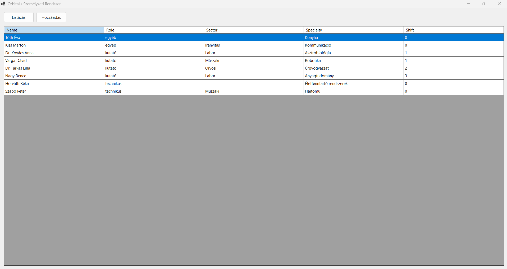
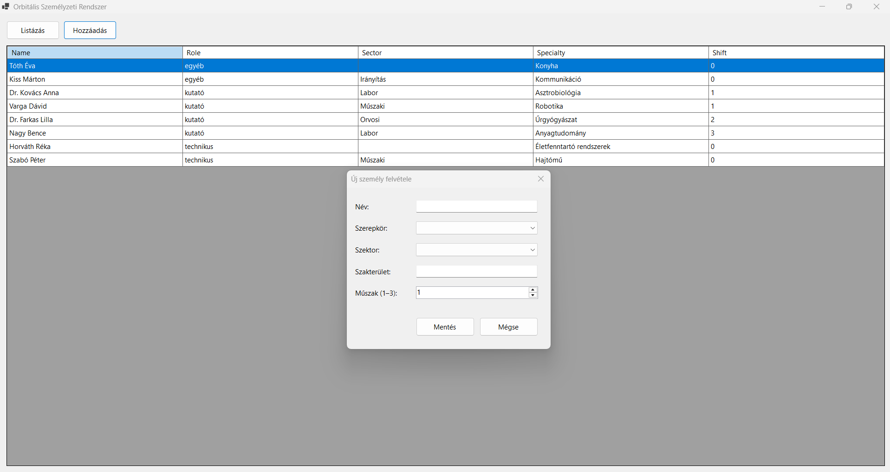
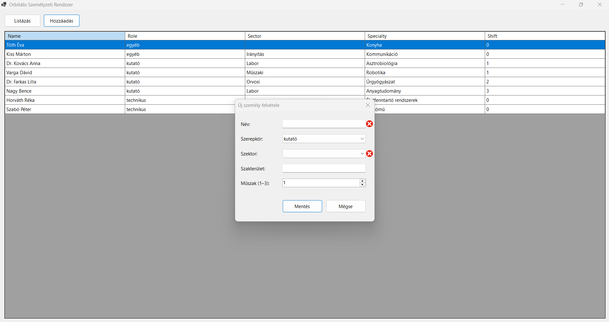

# Orbitális Személyzeti Rendszer

Egy C# / Windows Forms asztali alkalmazás egy kitalált űrállomás, a **Helios** fedélzeten dolgozó személyzet nyilvántartására. A projekt kicsi, de egy tipikus, rétegzett .NET asztali alkalmazás minden fontos elemét bemutatja: **Entity Framework Core Code-First** adatelérést, **SQLite** adatbázist, **Dependency Injectiont**, **LINQ**-alapú lekérdezést és űrlap-validációt.

## Képernyőképek

| Főablak | Új személy felvétele | Validációs hiba |
|---|---|---|
|  |  |  |

## Tartalom

- [A projekt háttere](#a-projekt-háttere)
- [Funkciók](#funkciók)
- [Használat](#használat)
- [Adatmodell és szabályok](#adatmodell-és-szabályok)
- [Technológiák](#technológiák)
- [A projekt felépítése](#a-projekt-felépítése)
- [Tervezési döntések](#tervezési-döntések)
- [Futtatás](#futtatás)
- [Tesztek](#tesztek)
- [Hibaelhárítás](#hibaelhárítás)
- [Továbbfejlesztési ötletek](#továbbfejlesztési-ötletek)

## A projekt háttere

A Helios űrállomásnak egyszerű eszközre van szüksége, amellyel nyilvántartható, kik dolgoznak a fedélzeten, milyen szerepkörben, melyik szektorban és melyik műszakban. Az alkalmazás ezt oldja meg: egy táblázatban mutatja a teljes személyzetet, és külön ablakban, ellenőrzött módon lehet új személyt felvenni.

A feladat egyben jó példa arra, hogyan lehet egy kis WinForms alkalmazást úgy felépíteni, hogy az adatelérés, a megjelenítés és a függőségek kezelése egymástól elkülönüljön.

## Funkciók

### Személyzet listázása

- Indításkor az alkalmazás beolvassa az adatbázis összes rekordját, és megjeleníti egy táblázatban.
- A **Listázás** gomb bármikor újra lekérdezi az adatokat az adatbázisból.
- A sorok rendezése: **szerepkör** (ABC) → **műszak** (növekvő) → **szektor** (ABC).
- Az azonosító (`ID`) nem látszik a táblázatban.
- A táblázat csak olvasható: a cellák nem szerkeszthetők, és nem lehet új sort sem beírni.

### Új személy felvétele

- A **Hozzáadás** gomb egy külön párbeszédablakot nyit.
- A **Mentés** ellenőrzi az adatokat. Hiba esetén a hibás mező mellett piros jelzés és üzenet jelenik meg, és az adat nem kerül az adatbázisba.
- Sikeres mentés után az ablak bezárul, és a főablak automatikusan frissíti a listát.
- A **Mégse** gomb bezárja az ablakot mentés nélkül.

## Használat

1. Indítsd el az alkalmazást. A főablakban megjelenik az adatbázisban lévő személyzet.
2. Kattints a **Hozzáadás** gombra.
3. Add meg a nevet, és válassz szerepkört (`kutató`, `technikus` vagy `egyéb`).
4. Kutatónál válassz szektort és műszakot (1–3). Más szerepkörnél a szektor elhagyható, a műszak pedig nem számít.
5. A szakterület mindig opcionális.
6. Kattints a **Mentés** gombra. Az új személy megjelenik a listában a rendezési szabály szerinti helyén.

## Adatmodell és szabályok

### `CrewMember`

| Mező | Típus | Leírás |
|---|---|---|
| `ID` | int | Egyedi azonosító (az adatbázis generálja) |
| `Name` | string | A személy neve |
| `Role` | string | `kutató`, `technikus` vagy `egyéb` |
| `Sector` | string | `Labor`, `Irányítás`, `Műszaki` vagy `Orvosi` |
| `Specialty` | string | Szakterület (opcionális) |
| `Shift` | int | Kutatók műszakja (1–3), minden más szerepkörnél 0 |

### Az űrlap szabályai

| Mező | Vezérlő | Szabály |
|---|---|---|
| Név | `TextBox` | Kötelező. A csak szóközökből álló név érvénytelen, a vezető és záró szóközök levágódnak. |
| Szerepkör | `ComboBox` (DropDownList) | Kötelező: `kutató` / `technikus` / `egyéb`. |
| Szektor | `ComboBox` (DropDownList) | **Kutatónál kötelező**, másoknál elhagyható (üresen mentődik). |
| Szakterület | `TextBox` | Opcionális. |
| Műszak | `NumericUpDown` | 1–3 között. **Csak kutatónál mentődik**, minden más szerepkörnél 0. |

## Technológiák

- C# és Windows Forms, **.NET 10** (Windows)
- **Entity Framework Core 10**, Code-First megközelítéssel, migrációkkal
- **SQLite** adatbázis
- **Dependency Injection** (`Microsoft.Extensions.DependencyInjection`)
- **LINQ** a lekérdezéshez, a rendezéshez és az azonosító elhagyásához
- **xUnit** tesztek (`Evaluation` projekt)

## A projekt felépítése

```text
.
├── Orbital.slnx                 # solution
├── Orbital/                     # az alkalmazás
│   ├── Context/CrewContext.cs   # EF Core DbContext
│   ├── Model/CrewMember.cs      # az adatmodell
│   ├── Migrations/              # EF Core migrációk
│   ├── View/
│   │   ├── StartUp.*            # főablak: lista + Listázás / Hozzáadás gomb
│   │   └── Add.*                # új személy felvétele (párbeszédablak)
│   ├── DB/crew.db               # SQLite adatbázis
│   └── Program.cs               # belépési pont, DI konfiguráció
├── Evaluation/                  # xUnit tesztek
└── docs/screenshots/            # a README képernyőképei
```

## Tervezési döntések

### Dependency Injection a `Program.cs`-ben

A szolgáltatások regisztrációja egy helyen történik, a `Program.cs`-ben:

```csharp
var services = new ServiceCollection();
services.AddSingleton<CrewContext>();
services.AddTransient<StartUp>();
services.AddTransient<Add>();
var serviceProvider = services.BuildServiceProvider();

Application.Run(serviceProvider.GetRequiredService<StartUp>());
```

- A **`CrewContext` singleton**, így a főablak és az Add ablak ugyanazt az adatbázis-kapcsolatot használja. Ha az Add ablak ment, a főablak ugyanabban a contextben látja az új rekordot.
- A két form **transient**, tehát minden megnyitáskor új példány készül. Az Add ablak így mindig üres mezőkkel nyílik meg, és bezárás után eldobható.
- Mindkét form konstruktora `IServiceProvider` paramétert kap, és ebből kéri el, amire szüksége van. A `StartUp` így az Add formot a konténerből éri el, nem `new Add()`-del hozza létre:

```csharp
private void AddCrewMember(object? sender, EventArgs e)
{
    using var addForm = _serviceProvider.GetRequiredService<Add>();
    if (addForm.ShowDialog() == DialogResult.OK)
    {
        LoadCrewMembers();
    }
}
```

A lista csak akkor frissül, ha az ablak `OK` eredménnyel zárult, vagyis ténylegesen történt mentés.

### LINQ: rendezés és az `ID` elhagyása `Select` projekcióval

```csharp
crewMemberGridView.DataSource = _context.CrewMembers
    .OrderBy(c => c.Role)
    .ThenBy(c => c.Shift)
    .ThenBy(c => c.Sector)
    .Select(c => new
    {
        c.Name,
        c.Role,
        c.Sector,
        c.Specialty,
        c.Shift
    })
    .ToList();
```

- Az `OrderBy` és a `ThenBy` láncolása adja a többszintű rendezést, és az egész SQL-ben fut le az adatbázison.
- A `Select` **névtelen típusba vetít**, amelyben nincs `ID`. Ezért az oszlop a táblázatban sem keletkezik. Ez tisztább megoldás, mint az oszlop elrejtése a `DataGridView`-ban, mert a felületre eleve csak az kerül, amit meg akarunk jeleníteni.

### Validáció `ErrorProvider`-rel

A `Save` eseménykezelő először törli a korábbi hibákat, ellenőrzi az összes szabályt, és csak akkor ment, ha mindegyik teljesül:

```csharp
errorProvider.Clear();

string name = nameTextBox.Text.Trim();
string? role = roleComboBox.SelectedItem?.ToString();
string? sector = sectorComboBox.SelectedItem?.ToString();
bool valid = true;

if (string.IsNullOrWhiteSpace(name))
{
    errorProvider.SetError(nameTextBox, "A név megadása kötelező.");
    valid = false;
}

if (role == null)
{
    errorProvider.SetError(roleComboBox, "A szerepkör kiválasztása kötelező.");
    valid = false;
}
else if (role == ResearcherRole && sector == null)
{
    errorProvider.SetError(sectorComboBox, "Kutatónál a szektor kiválasztása kötelező.");
    valid = false;
}

if (!valid)
{
    return;
}
```

- Az ellenőrzés **nem áll meg az első hibánál**: az összes hibás mező egyszerre jelzést kap, így a felhasználónak nem kell többször próbálkoznia.
- A műszak szabályát a mentés pillanatában érvényesítjük: csak kutatónál olvassuk ki a `NumericUpDown` értékét, minden mást 0-ra állítunk.

```csharp
Shift = role == ResearcherRole ? (int)shiftUpDown.Value : 0
```

### Adatbázis és migrációk

A séma kódból épül (**Code-First**): a `CrewMember` osztályból készül az `InitialCreate` migráció, amely létrehozza a `CrewMembers` táblát. A `CrewContext` az SQLite útvonalát (`../../../DB/crew.db`) a futtatási könyvtárhoz képest relatívan adja meg.

## Futtatás

### Követelmények

- Windows
- [.NET 10 SDK](https://dotnet.microsoft.com/download)
- Visual Studio, amely támogatja a `.slnx` formátumot és a .NET 10-et (ajánlott)

### Indítás

1. Klónozd a repót, és nyisd meg az `Orbital.slnx` fájlt Visual Studióban.
2. Állítsd az **Orbital** projektet kezdőprojektnek (jobb klikk → *Set as Startup Project*).
3. Indítsd el az alkalmazást (`F5`).

Az adatbázis útvonala a program futtatási könyvtárához képest relatív, ezért az alkalmazást Visual Studióból, vagy a build kimeneti mappájából (`Orbital/bin/Debug/net10.0-windows/`) indítsd. A `dotnet run` a projekt mappájából indul, így ott az útvonal rossz helyre mutat.

### Az adatbázis újragenerálása

A repóban egy üres, kész `Orbital/DB/crew.db` van. Ha újra létre akarod hozni, töröld a fájlt, és a Visual Studio **Package Manager Console** ablakában (Tools → NuGet Package Manager), az **Orbital** projektet kiválasztva futtasd:

```powershell
Update-Database
```

Ellenőrizd, hogy a `crew.db` az `Orbital/DB/` mappába került-e. Ha máshol keletkezett, másold át oda.

Új migrációt a modell módosítása után így készíthetsz:

```powershell
Add-Migration MigracioNeve
Update-Database
```

## Tesztek

Az `Evaluation` projekt 19 xUnit tesztje a következőket ellenőrzi:

| Terület | Mit vizsgál |
|---|---|
| Modell | A `CrewMember` publikus, a property-k neve, típusa és hozzáférése megfelelő |
| Adatbázis | A `DbSet` létezik, az EF Core menti és visszaolvassa az entitást, van Code-First migráció |
| Dependency Injection | Mindkét form rendelkezik `IServiceProvider` konstruktorral |
| Add form – felépítés | A vezérlők léteznek, a ComboBoxok DropDownList stílusúak és tartalmazzák a megfelelő értékeket, a műszak tartománya 1–3 |
| Add form – mentés | Érvényes kutató, technikus és egyéb szerepkör mentése, nem kutatónál a műszak 0 |
| Add form – validáció | Üres és szóközös név, hiányzó kutatói szektor: nincs mentés, az `ErrorProvider` hibát jelez |
| Add form – mégse | `DialogResult.Cancel`, nincs mentés |
| Főablak | Vezérlők, feliratok, ablakcím, betöltés indításkor, `ID` nélkül, rendezés, frissítés a Listázás gombra |

A tesztek memóriában futó SQLite adatbázist használnak, a `crew.db` fájlhoz nem nyúlnak.

Visual Studióban: *Test → Run All Tests*. Parancssorból a repó gyökeréből:

```powershell
dotnet test .\Evaluation\Evaluation.csproj
```

## Hibaelhárítás

Ha a repót zipként töltöd le, és a build azt írja, hogy egy `.resx` fájlt nem tud feldolgozni a „Mark of the Web" miatt, a repó gyökeréből oldd fel a fájlokat:

```powershell
Get-ChildItem -Path . -Recurse -File | Unblock-File
```

Gitből klónozva ez nem fordul elő.

## Továbbfejlesztési ötletek

- Személy szerkesztése és törlése a táblázatból
- Keresés és szűrés név, szerepkör vagy szektor szerint
- Export CSV-be
- A validáció kiemelése külön osztályba, hogy külön is tesztelhető legyen
- A `Role` és a `Sector` értékeinek lecserélése `enum`-ra
- Az adatbázis automatikus létrehozása az első indításkor
